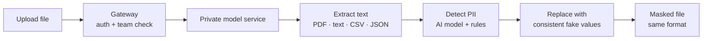

<div align="center">

# 🛡️ PII Masking System

**Share documents, not identities.**
Automatically find and replace names, IDs, addresses, phone numbers and more in PDFs, text, CSV and JSON, without breaking the file.

[](LICENSE)


**🌍 Read this in:**
**English** · [Nederlands](docs/readme/README.nl.md) · [Français](docs/readme/README.fr.md) · [Deutsch](docs/readme/README.de.md) · [Español](docs/readme/README.es.md) · [Română](docs/readme/README.ro.md) · [العربية](docs/readme/README.ar.md) · [简体中文](docs/readme/README.zh-CN.md)

</div>

---

## Why you'll want this

Sharing a clinical letter, an HR file or a support ticket with a vendor, a research team or a test environment usually means someone has to black out the personal data by hand. That is slow, and one missed name is a leak.

PII Masking System does it for you:

- 📄 **Keeps the document intact.** A PDF goes in, a PDF comes out. The same goes for text, CSV and JSON.
- 🎭 **Replaces, doesn't just delete.** Detected values become realistic fake ones (a different name, a valid-looking ID), the same way every time, so the masked file still reads naturally and stays useful for testing and analysis.
- 🔒 **Actually removes the data.** PDF text is redacted out of the file, and scanned pages can be read with OCR and have their pixels removed. Nothing hides underneath a black box.
- 🌍 **Works across languages.** Detection runs every country's rules on every document, so a French ID inside a Dutch letter is still found. Replacements are written in the document's own language (Dutch/Belgian, French, German, Spanish, Romanian, English).
- 🧪 **Pick the best model for the job.** Three independently built AI models sit behind one API, and a built-in leaderboard scores them identically on the same test set.
- 🧱 **Safe by design.** Only the gateway is exposed. Models run on a private network, requests are authenticated, and the audit log never contains the detected values.

## What it detects

Names, dates, ages, gender, organizations, addresses, phone numbers, emails, URLs, and national and healthcare identifiers (for example Belgian INSZ/NISS, RIZIV/INAMI and VAT numbers, plus French, German, Spanish and UK/US identifiers) with checksum validation to cut false positives.

## How it works



One public HTTP endpoint (`POST /v1/mask`) fronts every model. The caller never chooses a model URL, so the platform stays in control of what runs.

## The models

| Model | Technology | File types | Status |
| --- | --- | --- | --- |
| **Octo** | XLM-RoBERTa + checksum-gated rules | PDF, text, CSV, JSON | Demo-ready |
| **Synthify** | GLiNER | PDF, text | Demo only |
| **Berts** | int8 ONNX MedRoBERTa / BERT / CamemBERT + shared rules | PDF, text | Wired for production, staging approval required |

All models run on CPU through ONNX Runtime.

## Quick start

```sh
cp .env.example .env              # set SERVICE_TOKEN to a long random value
docker compose --profile octo up --detach --no-build
curl http://localhost:8080/health # {"status":"UP"}
```

Mask a text file:

```sh
curl -sS -X POST http://localhost:8080/v1/mask \
  -H "Authorization: Bearer $SERVICE_TOKEN" \
  -H "X-Request-ID: demo-001" -H "Idempotency-Key: demo-001" \
  -H "X-Team-ID: octo" \
  -H "X-Source-Object-Key: incoming/octo/demo-001/letter.txt" \
  -H "X-Source-ETag: demo" \
  -H "Content-Type: text/plain" -H "Accept: text/plain" \
  --data-binary @letter.txt -o masked.txt
```

Prefer clicking? Import the [Postman collection](postman/README.md). Full header list and every endpoint: [docs/current-endpoints.md](docs/current-endpoints.md). Local demo details: [docs/multimodel-deployment.md](docs/multimodel-deployment.md).

> **Model weights are not included in this public repository** (they are large and some carry third-party licences, see [NOTICE](NOTICE)). Export or add your own artifacts under `teams/<team>/onnx/`; see [docs/team-onboarding.md](docs/team-onboarding.md). The quick start below needs them in place.

## Documentation

| Read | To learn |
| --- | --- |
| [Architecture](docs/architecture.md) | How the pieces fit together |
| [Repository guide](docs/repository-guide.md) | Who owns which directory |
| [Team onboarding](docs/team-onboarding.md) | How to add or improve a model |
| [API contracts](contracts/masking-api/) | The versioned HTTP contract |
| [Security and secrets](docs/security-and-secrets.md) | Handling credentials and data |
| [Decision records](docs/decisions/) | Why things are the way they are |

## Contributing and security

Read [CONTRIBUTING.md](CONTRIBUTING.md) first. This repository accepts **synthetic data only**; never commit real personal data or credentials. To report a vulnerability, follow [SECURITY.md](SECURITY.md) and do not open a public issue with the details.

## License

Code is licensed under the [Apache License 2.0](LICENSE). Model artifacts are offered under Apache-2.0 where the contributors hold the rights, but each model also remains subject to the license of the upstream model it was built from. See [NOTICE](NOTICE) for the per-model details, including one set of weights whose upstream license is not yet confirmed.

---

# Development

The sections below are for people working on the repository itself.

## CI/CD

CI/CD is defined in [.gitlab-ci.yml](.gitlab-ci.yml) and fragments under [ci/](ci/). Merge requests run `build`, `validate`, `evaluate`, `package`, `security`, and the verified-candidate `release` stage. Ordinary jobs require the self-hosted `vps-ci` Docker runner; the optional full-corpus gate uses the separate `gpu` runner.

Merge requests run fast checks and change-selected ML jobs. Release-relevant merge requests also publish immutable SHA images, scan them, and record a verified production candidate. Default-branch pipelines contain only candidate loading and the two blocking manual production jobs; they never rebuild, republish, or rescan images. See [CI production promotion](docs/ci-production-promotion.md), the [VPS runner guide](docs/vps-gitlab-runner.md), and the [production deployment guide](deploy/README.md).

## Local checks

```sh
uv sync --locked
uv run python scripts/validate_repository.py
uv run python evaluation/scripts/validate_contracts.py
uv run python platform/masking-gateway/tests/test_gateway.py
uv run python platform/model-service/tests/test_service.py
uv run python platform/masking-gateway/tests/test_document_pipeline.py
uv run python platform/masking-gateway/tests/test_converter_samples.py
uv run python platform/masking-gateway/tests/test_orchestrator.py
uv run python platform/masking-gateway/tests/test_shared_adapter.py
uv run python platform/masking-gateway/tests/test_qa_label_schema.py
uv run python platform/masking-gateway/tests/test_pdf_line_reflow.py
uv run python platform/masking-gateway/tests/test_pdf_unmaskable_channels.py
uv run python tests/test_repository_layout.py
PYTHONPATH=evaluation uv run python -m pytest -q evaluation/tests
uv run pre-commit run --all-files --show-diff-on-failure
```

## Test tiers

| Tier / stage | CI behavior | Checks |
| --- | --- | --- |
| Fast — `build`, `validate` | Every merge-request pipeline | Lockfile and syntax checks, repository layout, gateway/model/document contracts, synthetic evaluation, formatting, and secret scanning |
| Mid — `evaluate` | When ML inputs change | LFS artifact integrity and CPU inference/API smoke tests |
| Package/security | Release-relevant merge requests | Rootless BuildKit publish, immutable digests, HIGH/CRITICAL image gates, and CycloneDX SBOMs |
| Release | Successful release-relevant merge requests and matching default-branch pipelines | Records then loads a strict candidate manifest for the merged SHA |
| Deploy | Default-branch pipeline after a candidate loads | Blocking manual preflight, then blocking manual blue/green promotion, canaries, Nginx switch, drain, and rollback |

## Pipeline budget

The pipeline avoids GitLab shared-runner minutes. Keep `GIT_LFS_SKIP_SMUDGE`, the `vps-ci` default tag, the consolidated `fast_checks` job, change-based package rules, and the duplicate-pipeline workflow guard unless an intentional capacity review approves a change.
