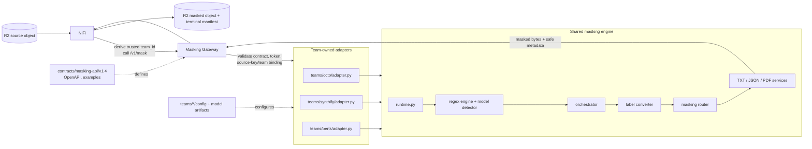
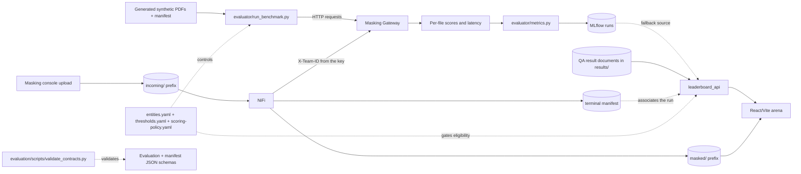
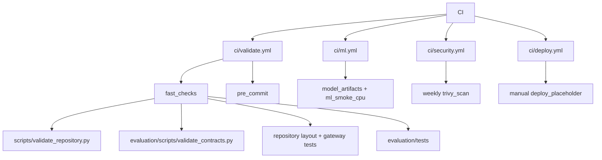

# Codebase graph

## Key ownership boundaries

| Area | Primary contents | Responsibility |
| --- | --- | --- |
| `contracts/` | API and terminal-manifest schemas | Stable integration contracts |
| `platform/masking-gateway/` | WSGI gateway and masking engine | External API, trust boundary, content masking |
| `platform/nifi/`, `platform/r2/`, `platform/mlflow/` | Operational conventions | Routing, storage, experiment tracking |
| `teams/` | Adapters, models, configs, tests, model cards | Independently evolved model implementations |
| `evaluation/` | Synthetic data, benchmark, scoring, leaderboard, masking console | Offline model comparison, presentation, and interactive pipeline demos |
| `ci/` | GitLab pipeline fragments | Fast validation, ML tiers, scheduled security, and manual deployment placeholder |
