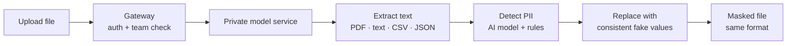

<div dir="rtl">

<div align="center">

# 🛡️ PII Masking System

**شارك المستندات، لا الهويات.**
اكتشف واستبدل تلقائياً الأسماء ومعرّفات الهوية والعناوين وأرقام الهواتف وغيرها في ملفات PDF والنصوص وCSV وJSON دون إتلاف الملف.

[](../../LICENSE)


🌍 اقرأ بـ:
[English](../../README.md) · [Nederlands](README.nl.md) · [Français](README.fr.md) · [Deutsch](README.de.md) · [Español](README.es.md) · [Română](README.ro.md) · **العربية** · [简体中文](README.zh-CN.md)

</div>

---

## لماذا تحتاجه

مشاركة تقرير طبي أو ملف موارد بشرية أو تذكرة دعم مع مورّد أو فريق بحث أو بيئة اختبار تعني عادةً أن يقوم شخص بإخفاء البيانات الشخصية يدوياً. هذا بطيء، واسم واحد يفوتك يعني تسريباً.

- 📄 **يبقى المستند سليماً.** تُدخل PDF وتحصل على PDF. وكذلك النص وCSV وJSON.
- 🎭 **يستبدل بدلاً من أن يحذف.** تتحول القيم المكتشفة إلى قيم وهمية واقعية (اسم مختلف، معرّف يبدو صالحاً) وبالطريقة نفسها في كل مرة، فيبقى الملف مقروءاً ومفيداً للاختبار والتحليل.
- 🔒 **يزيل البيانات فعلاً.** يُحذف نص PDF من الملف نفسه؛ ويمكن قراءة الصفحات الممسوحة ضوئياً بتقنية OCR وإزالة بكسلاتها. لا شيء يختبئ تحت مستطيل أسود.
- 🌍 **يعمل بعدة لغات.** يطبّق الكشف قواعد كل بلد على كل مستند، فيُكتشف معرّف فرنسي داخل رسالة هولندية. وتُكتب البدائل بلغة المستند (الهولندية/البلجيكية، الفرنسية، الألمانية، الإسبانية، الرومانية، الإنجليزية).
- 🧪 **اختر أفضل نموذج.** ثلاثة نماذج ذكاء اصطناعي بُنيت بشكل مستقل خلف واجهة API واحدة، ولوحة صدارة مدمجة تقيّمها بالطريقة نفسها على مجموعة الاختبار نفسها.
- 🧱 **آمن بالتصميم.** البوابة وحدها مكشوفة. تعمل النماذج على شبكة خاصة، والطلبات موثّقة، ولا يحتوي سجل التدقيق أبداً على القيم المكتشفة.

## ما الذي يكتشفه

الأسماء والتواريخ والأعمار والجنس والمؤسسات والعناوين وأرقام الهواتف والبريد الإلكتروني والروابط ومعرّفات الهوية الوطنية والصحية (مثل أرقام INSZ/NISS وRIZIV/INAMI وضريبة القيمة المضافة البلجيكية، إضافة إلى معرّفات فرنسية وألمانية وإسبانية وبريطانية/أمريكية)، مع التحقق بمجموع اختباري لتقليل الإنذارات الكاذبة.

## كيف يعمل



نقطة نهاية HTTP عامة واحدة (`POST /v1/mask`) تقف أمام كل نموذج. لا يختار المستدعي عنوان URL لأي نموذج، فتبقى المنصة هي المتحكمة فيما يعمل.

## النماذج

| النموذج | التقنية | أنواع الملفات | الحالة |
| --- | --- | --- | --- |
| **Octo** | XLM-RoBERTa + قواعد بمجموع اختباري | PDF، نص، CSV، JSON | جاهز للعرض التجريبي |
| **Synthify** | GLiNER | PDF، نص | عرض تجريبي فقط |
| **Berts** | int8 ONNX MedRoBERTa / BERT / CamemBERT + قواعد مشتركة | PDF، نص | موصول بالإنتاج، يتطلب موافقة بيئة staging |

تعمل جميع النماذج على المعالج (CPU) عبر ONNX Runtime.

## بداية سريعة

```sh
cp .env.example .env              # set SERVICE_TOKEN to a long random value
docker compose --profile octo up --detach --no-build
curl http://localhost:8080/health # {"status":"UP"}
```

إخفاء بيانات ملف نصي:

```sh
curl -sS -X POST http://localhost:8080/v1/mask \
  -H "Authorization: Bearer $SERVICE_TOKEN" \
  -H "X-Request-ID: demo-001" -H "Idempotency-Key: demo-001" \
  -H "X-Team-ID: octo" \
  -H "X-Source-Object-Key: incoming/octo/demo-001/letter.txt" \
  -H "X-Source-ETag: demo" \
  -H "Content-Type: text/plain" -H "Accept: text/plain" \
  --data-binary @letter.txt -o masked.txt
```

تفضّل النقر؟ استورد [مجموعة Postman](../../postman/README.md). القائمة الكاملة للترويسات وجميع نقاط النهاية: [docs/current-endpoints.md](../../docs/current-endpoints.md). تفاصيل العرض المحلي: [docs/multimodel-deployment.md](../../docs/multimodel-deployment.md).

> **أوزان النماذج غير مشمولة في هذا المستودع العام** (حجمها كبير وبعضها يخضع لتراخيص أطراف ثالثة، راجع [NOTICE](../../NOTICE)). صدّر أو أضف ملفاتك الخاصة ضمن `teams/<team>/onnx/`؛ راجع [docs/team-onboarding.md](../../docs/team-onboarding.md). البداية السريعة أدناه تحتاجها.

## التوثيق

| اقرأ | لتتعرف على |
| --- | --- |
| [البنية](../../docs/architecture.md) | كيف تتكامل الأجزاء |
| [دليل المستودع](../../docs/repository-guide.md) | من يملك كل مجلد |
| [انضمام الفرق](../../docs/team-onboarding.md) | كيف تضيف نموذجاً أو تحسّنه |
| [عقود API](../../contracts/masking-api/) | عقد HTTP المُصدَّر بإصدارات |
| [الأمان والأسرار](../../docs/security-and-secrets.md) | التعامل مع بيانات الاعتماد والبيانات |
| [سجلات القرارات](../../docs/decisions/) | لماذا الأمور على ما هي عليه |

## المساهمة والأمان

اقرأ [CONTRIBUTING.md](../../CONTRIBUTING.md) أولاً. يقبل هذا المستودع **بيانات اصطناعية فقط**؛ لا ترفع أبداً بيانات شخصية حقيقية أو بيانات اعتماد. للإبلاغ عن ثغرة اتبع [SECURITY.md](../../SECURITY.md) ولا تفتح issue عاماً يتضمن التفاصيل.

## الترخيص

الشيفرة مرخّصة بموجب [Apache License 2.0](../../LICENSE). تُقدَّم ملفات النماذج بموجب Apache-2.0 حيثما يملك المساهمون الحقوق، لكن يبقى كل نموذج خاضعاً أيضاً لترخيص النموذج الأصلي الذي بُني منه. راجع [NOTICE](../../NOTICE) لتفاصيل كل نموذج، بما في ذلك مجموعة أوزان لم يتأكد ترخيصها الأصلي بعد.

---

للمطورين: راجع قسم *Development* في [README الإنجليزي](../../README.md).

</div>
