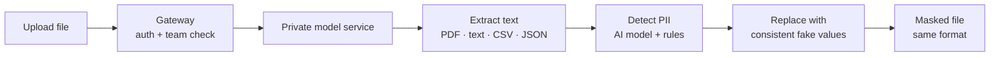

<div align="center">

# 🛡️ PII Masking System

**Dokumente teilen, nicht Identitäten.**
Namen, IDs, Adressen, Telefonnummern und mehr in PDF, Text, CSV und JSON automatisch finden und ersetzen, ohne die Datei zu beschädigen.

[](../../LICENSE)


🌍 Lesen auf:
[English](../../README.md) · [Nederlands](README.nl.md) · [Français](README.fr.md) · **Deutsch** · [Español](README.es.md) · [Română](README.ro.md) · [العربية](README.ar.md) · [简体中文](README.zh-CN.md)

</div>

---

## Warum Sie das brauchen

Wer einen Arztbrief, eine Personalakte oder ein Support-Ticket an einen Dienstleister, ein Forschungsteam oder eine Testumgebung weitergibt, muss die personenbezogenen Daten meist von Hand schwärzen. Das ist langsam, und ein übersehener Name ist ein Datenleck.

- 📄 **Das Dokument bleibt intakt.** PDF rein, PDF raus. Genauso bei Text, CSV und JSON.
- 🎭 **Ersetzt statt zu löschen.** Erkannte Werte werden durch realistische Platzhalter ersetzt (anderer Name, gültig aussehende ID), jedes Mal gleich, damit die Datei lesbar und für Tests und Analysen nutzbar bleibt.
- 🔒 **Entfernt die Daten wirklich.** PDF-Text wird aus der Datei geschwärzt; gescannte Seiten können per OCR gelesen und ihre Pixel entfernt werden. Nichts versteckt sich unter einem schwarzen Balken.
- 🌍 **Mehrsprachig.** Die Erkennung wendet die Regeln aller Länder auf jedes Dokument an, sodass eine französische ID in einem niederländischen Brief ebenfalls gefunden wird. Ersetzungen werden in der Sprache des Dokuments geschrieben (Niederländisch/Belgisch, Französisch, Deutsch, Spanisch, Rumänisch, Englisch).
- 🧪 **Das beste Modell wählen.** Drei unabhängig entwickelte KI-Modelle hinter einer API, und eine integrierte Rangliste bewertet sie auf demselben Testset identisch.
- 🧱 **Sicher von Grund auf.** Nur das Gateway ist erreichbar. Modelle laufen in einem privaten Netzwerk, Anfragen sind authentifiziert und das Audit-Log enthält nie die erkannten Werte.

## Was erkannt wird

Namen, Daten, Alter, Geschlecht, Organisationen, Adressen, Telefonnummern, E-Mails, URLs sowie nationale und Gesundheits-Kennungen (z. B. belgische INSZ/NISS-, RIZIV/INAMI- und USt-Nummern sowie französische, deutsche, spanische und UK/US-Kennungen), mit Prüfsummenvalidierung gegen Fehlalarme.

## So funktioniert es



Ein einziger öffentlicher HTTP-Endpunkt (`POST /v1/mask`) steht vor jedem Modell. Der Aufrufer wählt nie eine Modell-URL, die Plattform behält also die Kontrolle darüber, was läuft.

## Die Modelle

| Modell | Technologie | Dateitypen | Status |
| --- | --- | --- | --- |
| **Octo** | XLM-RoBERTa + prüfsummengeprüfte Regeln | PDF, Text, CSV, JSON | Demo-bereit |
| **Synthify** | GLiNER | PDF, Text | Nur Demo |
| **Berts** | int8 ONNX MedRoBERTa / BERT / CamemBERT + gemeinsame Regeln | PDF, Text | Für Produktion angebunden, Staging-Freigabe nötig |

Alle Modelle laufen über ONNX Runtime auf der CPU.

## Schnellstart

```sh
cp .env.example .env              # set SERVICE_TOKEN to a long random value
docker compose --profile octo up --detach --no-build
curl http://localhost:8080/health # {"status":"UP"}
```

Eine Textdatei maskieren:

```sh
curl -sS -X POST http://localhost:8080/v1/mask \
  -H "Authorization: Bearer $SERVICE_TOKEN" \
  -H "X-Request-ID: demo-001" -H "Idempotency-Key: demo-001" \
  -H "X-Team-ID: octo" \
  -H "X-Source-Object-Key: incoming/octo/demo-001/letter.txt" \
  -H "X-Source-ETag: demo" \
  -H "Content-Type: text/plain" -H "Accept: text/plain" \
  --data-binary @letter.txt -o masked.txt
```

Lieber klicken? Importieren Sie die [Postman-Collection](../../postman/README.md). Vollständige Header-Liste und alle Endpunkte: [docs/current-endpoints.md](../../docs/current-endpoints.md). Details zur lokalen Demo: [docs/multimodel-deployment.md](../../docs/multimodel-deployment.md).

> **Modellgewichte sind in diesem öffentlichen Repository nicht enthalten** (sie sind groß und einige unterliegen Drittlizenzen, siehe [NOTICE](../../NOTICE)). Exportieren oder legen Sie eigene Artefakte unter `teams/<team>/onnx/` ab; siehe [docs/team-onboarding.md](../../docs/team-onboarding.md). Der Schnellstart unten setzt sie voraus.

## Dokumentation

| Lesen | Zum Verstehen von |
| --- | --- |
| [Architektur](../../docs/architecture.md) | Wie die Teile zusammenpassen |
| [Repository-Leitfaden](../../docs/repository-guide.md) | Wem welches Verzeichnis gehört |
| [Team-Onboarding](../../docs/team-onboarding.md) | Wie man ein Modell hinzufügt oder verbessert |
| [API-Verträge](../../contracts/masking-api/) | Der versionierte HTTP-Vertrag |
| [Sicherheit und Geheimnisse](../../docs/security-and-secrets.md) | Umgang mit Zugangsdaten und Daten |
| [Entscheidungsprotokolle](../../docs/decisions/) | Warum die Dinge so sind, wie sie sind |

## Mitwirken und Sicherheit

Lesen Sie zuerst [CONTRIBUTING.md](../../CONTRIBUTING.md). Dieses Repository akzeptiert **ausschließlich synthetische Daten**; committen Sie niemals echte personenbezogene Daten oder Zugangsdaten. Sicherheitslücken melden Sie gemäß [SECURITY.md](../../SECURITY.md), ohne ein öffentliches Issue mit Details zu eröffnen.

## Lizenz

Der Code steht unter der [Apache License 2.0](../../LICENSE). Modellartefakte werden unter Apache-2.0 angeboten, soweit die Mitwirkenden die Rechte besitzen; jedes Modell unterliegt aber weiterhin der Lizenz des zugrunde liegenden Upstream-Modells. Details pro Modell, einschließlich eines Gewichtssatzes, dessen Upstream-Lizenz noch nicht bestätigt ist, stehen in [NOTICE](../../NOTICE).

---

Entwickler: siehe den Abschnitt *Development* in der [englischen README](../../README.md).
