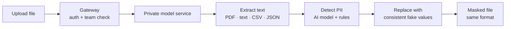

<div align="center">

# 🛡️ PII Masking System

**Comparte documentos, no identidades.**
Encuentra y sustituye automáticamente nombres, identificadores, direcciones, teléfonos y más en PDF, texto, CSV y JSON, sin romper el archivo.

[](../../LICENSE)


🌍 Leer en:
[English](../../README.md) · [Nederlands](README.nl.md) · [Français](README.fr.md) · [Deutsch](README.de.md) · **Español** · [Română](README.ro.md) · [العربية](README.ar.md) · [简体中文](README.zh-CN.md)

</div>

---

## Por qué lo querrás

Compartir un informe clínico, un expediente de RR. HH. o un ticket de soporte con un proveedor, un equipo de investigación o un entorno de pruebas suele obligar a alguien a tapar los datos personales a mano. Es lento, y un nombre olvidado es una fuga.

- 📄 **El documento queda intacto.** Entra un PDF, sale un PDF. Igual con texto, CSV y JSON.
- 🎭 **Sustituye en vez de borrar.** Los valores detectados se convierten en valores ficticios realistas (otro nombre, un ID de apariencia válida), siempre iguales, de modo que el archivo sigue siendo legible y útil para pruebas y análisis.
- 🔒 **Elimina los datos de verdad.** El texto del PDF se redacta fuera del archivo; las páginas escaneadas pueden leerse con OCR y sus píxeles se eliminan. Nada queda oculto bajo un recuadro negro.
- 🌍 **Funciona en varios idiomas.** La detección aplica las reglas de todos los países a cada documento, así que un ID francés dentro de una carta neerlandesa también se encuentra. Las sustituciones se escriben en el idioma del documento (neerlandés/belga, francés, alemán, español, rumano, inglés).
- 🧪 **Elige el mejor modelo.** Tres modelos de IA construidos de forma independiente detrás de una sola API, y un ranking integrado los puntúa por igual con el mismo conjunto de pruebas.
- 🧱 **Seguro por diseño.** Solo la pasarela está expuesta. Los modelos se ejecutan en una red privada, las peticiones están autenticadas y el registro de auditoría nunca contiene los valores detectados.

## Qué detecta

Nombres, fechas, edades, género, organizaciones, direcciones, teléfonos, correos, URL e identificadores nacionales y sanitarios (por ejemplo INSZ/NISS, RIZIV/INAMI y números de IVA belgas, además de identificadores franceses, alemanes, españoles y UK/US), con validación por suma de comprobación para reducir falsos positivos.

## Cómo funciona



Un único endpoint HTTP público (`POST /v1/mask`) da acceso a todos los modelos. Quien llama nunca elige la URL de un modelo, así la plataforma controla qué se ejecuta.

## Los modelos

| Modelo | Tecnología | Tipos de archivo | Estado |
| --- | --- | --- | --- |
| **Octo** | XLM-RoBERTa + reglas con suma de comprobación | PDF, texto, CSV, JSON | Listo para demo |
| **Synthify** | GLiNER | PDF, texto | Solo demo |
| **Berts** | int8 ONNX MedRoBERTa / BERT / CamemBERT + reglas compartidas | PDF, texto | Conectado a producción, requiere aprobación de staging |

Todos los modelos se ejecutan en CPU mediante ONNX Runtime.

## Inicio rápido

```sh
uv run --no-project --with kagglehub python scripts/fetch_models.py --team octo   # download the weights
cp .env.example .env              # set SERVICE_TOKEN to a long random value
docker compose --profile octo up --detach --build
curl http://localhost:8080/health # {"status":"UP"}
```

Los pesos de los modelos no están en este repositorio. Se alojan en [Kaggle](https://www.kaggle.com/models/yassienwasfy/pii-masking-system) con una ficha de modelo y una licencia por modelo; `scripts/fetch_models.py` los descarga y comprueba cada archivo con un SHA-256 fijado en el script. Los tres checkpoints de Berts provienen de terceros cuya licencia no está confirmada, véase [NOTICE](../../NOTICE).

Enmascarar un archivo de texto:

```sh
curl -sS -X POST http://localhost:8080/v1/mask \
  -H "Authorization: Bearer $SERVICE_TOKEN" \
  -H "X-Request-ID: demo-001" -H "Idempotency-Key: demo-001" \
  -H "X-Team-ID: octo" \
  -H "X-Source-Object-Key: incoming/octo/demo-001/letter.txt" \
  -H "X-Source-ETag: demo" \
  -H "Content-Type: text/plain" -H "Accept: text/plain" \
  --data-binary @letter.txt -o masked.txt
```

¿Prefieres hacer clic? Importa la [colección de Postman](../../postman/README.md). Lista completa de cabeceras y todos los endpoints: [docs/current-endpoints.md](../../docs/current-endpoints.md). Detalles de la demo local: [docs/multimodel-deployment.md](../../docs/multimodel-deployment.md).

> **Los pesos de los modelos no se incluyen en este repositorio público** (son grandes y algunos tienen licencias de terceros, ver [NOTICE](../../NOTICE)). Exporta o añade tus propios artefactos en `teams/<team>/onnx/`; consulta [docs/team-onboarding.md](../../docs/team-onboarding.md). El inicio rápido de abajo los necesita.

## Documentación

| Lee | Para entender |
| --- | --- |
| [Arquitectura](../../docs/architecture.md) | Cómo encajan las piezas |
| [Guía del repositorio](../../docs/repository-guide.md) | Quién es dueño de cada directorio |
| [Incorporación de equipos](../../docs/team-onboarding.md) | Cómo añadir o mejorar un modelo |
| [Contratos de API](../../contracts/masking-api/) | El contrato HTTP versionado |
| [Seguridad y secretos](../../docs/security-and-secrets.md) | Manejo de credenciales y datos |
| [Registros de decisiones](../../docs/decisions/) | Por qué las cosas son como son |

## Contribuir y seguridad

Lee primero [CONTRIBUTING.md](../../CONTRIBUTING.md). Este repositorio acepta **solo datos sintéticos**; nunca subas datos personales reales ni credenciales. Para informar de una vulnerabilidad, sigue [SECURITY.md](../../SECURITY.md) y no abras un issue público con los detalles.

## Licencia

El código se distribuye bajo la [licencia Apache 2.0](../../LICENSE). Los artefactos de modelo se ofrecen bajo Apache-2.0 cuando los colaboradores poseen los derechos, pero cada modelo sigue sujeto a la licencia del modelo original del que deriva. Consulta [NOTICE](../../NOTICE) para el detalle por modelo, incluido un conjunto de pesos cuya licencia original aún no está confirmada.

---

Desarrolladores: consulta la sección *Development* del [README en inglés](../../README.md).
