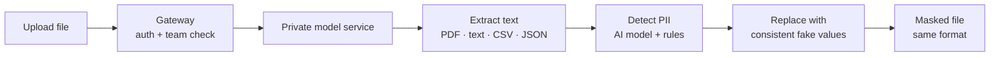

<div align="center">

# 🛡️ PII Masking System

**Partagez des documents, pas des identités.**
Détectez et remplacez automatiquement noms, identifiants, adresses, numéros de téléphone et plus dans les PDF, textes, CSV et JSON, sans casser le fichier.

[](../../LICENSE)


🌍 Lire en :
[English](../../README.md) · [Nederlands](README.nl.md) · **Français** · [Deutsch](README.de.md) · [Español](README.es.md) · [Română](README.ro.md) · [العربية](README.ar.md) · [简体中文](README.zh-CN.md)

</div>

---

## Pourquoi vous en aurez besoin

Partager un courrier médical, un dossier RH ou un ticket de support avec un prestataire, une équipe de recherche ou un environnement de test oblige souvent quelqu'un à masquer les données personnelles à la main. C'est lent, et un seul nom oublié est une fuite.

- 📄 **Le document reste intact.** Un PDF en entrée, un PDF en sortie. Idem pour le texte, le CSV et le JSON.
- 🎭 **Remplace au lieu de supprimer.** Les valeurs détectées deviennent des valeurs fictives réalistes (autre nom, identifiant d'apparence valide), toujours identiques d'une fois sur l'autre, pour que le fichier reste lisible et utile pour les tests et l'analyse.
- 🔒 **Supprime vraiment les données.** Le texte du PDF est expurgé du fichier ; les pages scannées peuvent être lues par OCR et leurs pixels supprimés. Rien ne se cache sous un rectangle noir.
- 🌍 **Multilingue.** La détection applique les règles de chaque pays à chaque document : un identifiant français dans une lettre néerlandaise est donc trouvé aussi. Les remplacements sont écrits dans la langue du document (néerlandais/belge, français, allemand, espagnol, roumain, anglais).
- 🧪 **Choisissez le meilleur modèle.** Trois modèles d'IA construits indépendamment derrière une seule API, et un classement intégré les évalue de façon identique sur le même jeu de test.
- 🧱 **Sûr par conception.** Seule la passerelle est exposée. Les modèles tournent sur un réseau privé, les requêtes sont authentifiées et le journal d'audit ne contient jamais les valeurs détectées.

## Ce qui est détecté

Noms, dates, âges, genre, organisations, adresses, numéros de téléphone, e-mails, URL, ainsi que des identifiants nationaux et de santé (par ex. INSZ/NISS, RIZIV/INAMI et numéros de TVA belges, plus des identifiants français, allemands, espagnols et UK/US), avec validation par somme de contrôle pour limiter les faux positifs.

## Comment ça marche



Un seul point d'accès HTTP public (`POST /v1/mask`) devant chaque modèle. L'appelant ne choisit jamais l'URL d'un modèle : la plateforme garde la maîtrise de ce qui s'exécute.

## Les modèles

| Modèle | Technologie | Types de fichiers | Statut |
| --- | --- | --- | --- |
| **Octo** | XLM-RoBERTa + règles à somme de contrôle | PDF, texte, CSV, JSON | Prêt pour la démo |
| **Synthify** | GLiNER | PDF, texte | Démo uniquement |
| **Berts** | int8 ONNX MedRoBERTa / BERT / CamemBERT + règles partagées | PDF, texte | Câblé pour la production, validation du staging requise |

Tous les modèles s'exécutent sur CPU via ONNX Runtime.

## Démarrage rapide

```sh
uv run --no-project --with kagglehub python scripts/fetch_models.py --team octo   # download the weights
cp .env.example .env              # set SERVICE_TOKEN to a long random value
docker compose --profile octo up --detach --build
curl http://localhost:8080/health # {"status":"UP"}
```

Les poids des modèles ne sont pas dans ce dépôt. Ils sont hébergés sur [Kaggle](https://www.kaggle.com/models/yassienwasfy/pii-masking-system) avec une fiche de modèle et une licence par modèle ; `scripts/fetch_models.py` les télécharge et vérifie chaque fichier par rapport à un SHA-256 fixé dans le script. Les trois checkpoints Berts proviennent de tiers dont la licence n'est pas confirmée, voir [NOTICE](../../NOTICE).

Masquer un fichier texte :

```sh
curl -sS -X POST http://localhost:8080/v1/mask \
  -H "Authorization: Bearer $SERVICE_TOKEN" \
  -H "X-Request-ID: demo-001" -H "Idempotency-Key: demo-001" \
  -H "X-Team-ID: octo" \
  -H "X-Source-Object-Key: incoming/octo/demo-001/letter.txt" \
  -H "X-Source-ETag: demo" \
  -H "Content-Type: text/plain" -H "Accept: text/plain" \
  --data-binary @letter.txt -o masked.txt
```

Vous préférez cliquer ? Importez la [collection Postman](../../postman/README.md). Liste complète des en-têtes et tous les endpoints : [docs/current-endpoints.md](../../docs/current-endpoints.md). Détails de la démo locale : [docs/multimodel-deployment.md](../../docs/multimodel-deployment.md).

> **Les poids des modèles ne sont pas inclus dans ce dépôt public** (ils sont volumineux et certains relèvent de licences tierces, voir [NOTICE](../../NOTICE)). Exportez ou ajoutez vos propres artefacts sous `teams/<team>/onnx/` ; voir [docs/team-onboarding.md](../../docs/team-onboarding.md). Le démarrage rapide ci-dessous en a besoin.

## Documentation

| À lire | Pour comprendre |
| --- | --- |
| [Architecture](../../docs/architecture.md) | Comment les pièces s'assemblent |
| [Guide du dépôt](../../docs/repository-guide.md) | Qui possède quel répertoire |
| [Intégration d'une équipe](../../docs/team-onboarding.md) | Comment ajouter ou améliorer un modèle |
| [Contrats d'API](../../contracts/masking-api/) | Le contrat HTTP versionné |
| [Sécurité et secrets](../../docs/security-and-secrets.md) | Gestion des secrets et des données |
| [Décisions d'architecture](../../docs/decisions/) | Pourquoi les choses sont ainsi |

## Contribuer et sécurité

Lisez d'abord [CONTRIBUTING.md](../../CONTRIBUTING.md). Ce dépôt n'accepte que des **données synthétiques** ; ne committez jamais de données personnelles réelles ni d'identifiants. Pour signaler une vulnérabilité, suivez [SECURITY.md](../../SECURITY.md) et n'ouvrez pas de ticket public avec les détails.

## Licence

Le code est sous [licence Apache 2.0](../../LICENSE). Les artefacts de modèle sont proposés sous Apache-2.0 lorsque les contributeurs détiennent les droits, mais chaque modèle reste aussi soumis à la licence du modèle amont dont il dérive. Voir [NOTICE](../../NOTICE) pour le détail par modèle, y compris un jeu de poids dont la licence amont n'est pas encore confirmée.

---

Développeurs : voir la section *Development* du [README anglais](../../README.md).
