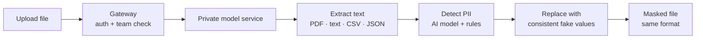

<div align="center">

# 🛡️ PII Masking System

**Deel documenten, niet identiteiten.**
Vind en vervang automatisch namen, ID's, adressen, telefoonnummers en meer in PDF, tekst, CSV en JSON, zonder het bestand te breken.

[](../../LICENSE)


🌍 Lees dit in:
[English](../../README.md) · **Nederlands** · [Français](README.fr.md) · [Deutsch](README.de.md) · [Español](README.es.md) · [Română](README.ro.md) · [العربية](README.ar.md) · [简体中文](README.zh-CN.md)

</div>

---

## Waarom je dit wilt

Een klinische brief, een HR-dossier of een supportticket delen met een leverancier, onderzoeksteam of testomgeving betekent meestal dat iemand de persoonsgegevens met de hand moet afdekken. Dat is traag, en één gemiste naam is een lek.

- 📄 **Het document blijft intact.** PDF erin, PDF eruit. Hetzelfde voor tekst, CSV en JSON.
- 🎭 **Vervangt, in plaats van te schrappen.** Gedetecteerde waarden worden realistische nepwaarden (andere naam, geldig ogend ID), telkens op dezelfde manier, zodat het bestand leesbaar en bruikbaar blijft voor tests en analyse.
- 🔒 **Verwijdert de data echt.** PDF-tekst wordt uit het bestand geredigeerd; gescande pagina's kunnen met OCR gelezen worden en hun pixels worden verwijderd. Niets zit verborgen onder een zwarte balk.
- 🌍 **Werkt in meerdere talen.** Detectie past de regels van elk land toe op elk document, dus een Frans ID in een Nederlandse brief wordt ook gevonden. Vervangingen worden in de taal van het document geschreven (Nederlands/Belgisch, Frans, Duits, Spaans, Roemeens, Engels).
- 🧪 **Kies het beste model.** Drie onafhankelijk gebouwde AI-modellen achter één API, en een ingebouwd leaderboard beoordeelt ze identiek op dezelfde testset.
- 🧱 **Veilig ontworpen.** Alleen de gateway is bereikbaar. Modellen draaien op een privénetwerk, aanvragen zijn geauthenticeerd en het auditlog bevat nooit de gedetecteerde waarden.

## Wat het detecteert

Namen, datums, leeftijden, geslacht, organisaties, adressen, telefoonnummers, e-mails, URL's en nationale en zorgidentificatoren (bv. Belgische INSZ/NISS-, RIZIV/INAMI- en btw-nummers, plus Franse, Duitse, Spaanse en UK/US-identificatoren), met checksumvalidatie om valse positieven te beperken.

## Hoe het werkt



Eén publiek HTTP-eindpunt (`POST /v1/mask`) staat voor elk model. De aanroeper kiest nooit een model-URL, zodat het platform controle houdt over wat draait.

## De modellen

| Model | Technologie | Bestandstypes | Status |
| --- | --- | --- | --- |
| **Octo** | XLM-RoBERTa + regels met checksum | PDF, tekst, CSV, JSON | Demo-klaar |
| **Synthify** | GLiNER | PDF, tekst | Alleen demo |
| **Berts** | int8 ONNX MedRoBERTa / BERT / CamemBERT + gedeelde regels | PDF, tekst | Productie-aangesloten, staging-goedkeuring vereist |
| **mDeBERTa** | mDeBERTa-v3 (36 labels, PII + clinical) + gedeelde regels | PDF, tekst, CSV, JSON | Alleen demo |

Alle modellen draaien op CPU via ONNX Runtime.

## Snel starten

```sh
uv run --no-project --with kagglehub python scripts/fetch_models.py --team octo   # download the weights
cp .env.example .env              # set SERVICE_TOKEN to a long random value
docker compose --profile octo up --detach --build
curl http://localhost:8080/health # {"status":"UP"}
```

De modelgewichten staan niet in deze repository. Ze worden gehost op [Kaggle](https://www.kaggle.com/models/yassienwasfy/pii-masking-system) met een modelkaart en een licentie per model; `scripts/fetch_models.py` downloadt ze en controleert elk bestand op een SHA-256 die in het script vastligt. De drie Berts-checkpoints zijn afkomstig van derden van wie de licentie niet is bevestigd, zie [NOTICE](../../NOTICE).

Een tekstbestand maskeren:

```sh
curl -sS -X POST http://localhost:8080/v1/mask \
  -H "Authorization: Bearer $SERVICE_TOKEN" \
  -H "X-Request-ID: demo-001" -H "Idempotency-Key: demo-001" \
  -H "X-Team-ID: octo" \
  -H "X-Source-Object-Key: incoming/octo/demo-001/letter.txt" \
  -H "X-Source-ETag: demo" \
  -H "Content-Type: text/plain" -H "Accept: text/plain" \
  --data-binary @letter.txt -o masked.txt
```

Liever klikken? Importeer de [Postman-collectie](../../postman/README.md). Volledige headerlijst en alle endpoints: [docs/current-endpoints.md](../../docs/current-endpoints.md). Details van de lokale demo: [docs/multimodel-deployment.md](../../docs/multimodel-deployment.md).

> **Modelgewichten zijn niet opgenomen in deze publieke repository** (ze zijn groot en sommige hebben licenties van derden, zie [NOTICE](../../NOTICE)). Exporteer of plaats je eigen artefacten onder `teams/<team>/onnx/`; zie [docs/team-onboarding.md](../../docs/team-onboarding.md). De snelle start hieronder heeft ze nodig.

## Documentatie

| Lees | Om te leren |
| --- | --- |
| [Architectuur](../../docs/architecture.md) | Hoe de onderdelen samenwerken |
| [Repositorygids](../../docs/repository-guide.md) | Wie welke map beheert |
| [Team-onboarding](../../docs/team-onboarding.md) | Een model toevoegen of verbeteren |
| [API-contracten](../../contracts/masking-api/) | Het versiebeheerde HTTP-contract |
| [Beveiliging en geheimen](../../docs/security-and-secrets.md) | Omgaan met geheimen en data |
| [Beslissingsdossiers](../../docs/decisions/) | Waarom dingen zijn zoals ze zijn |

## Bijdragen en beveiliging

Lees eerst [CONTRIBUTING.md](../../CONTRIBUTING.md). Deze repository accepteert **alleen synthetische data**; commit nooit echte persoonsgegevens of inloggegevens. Meld een kwetsbaarheid via [SECURITY.md](../../SECURITY.md) en open geen openbaar issue met details.

## Licentie

De code valt onder de [Apache License 2.0](../../LICENSE). Modelartefacten worden onder Apache-2.0 aangeboden waar de bijdragers de rechten bezitten, maar elk model blijft ook onderworpen aan de licentie van het onderliggende model. Zie [NOTICE](../../NOTICE) voor de details per model, inclusief één set gewichten waarvan de upstream-licentie nog niet bevestigd is.

---

Ontwikkelaars: zie de sectie *Development* in de [Engelse README](../../README.md).
