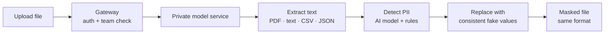

<div align="center">

# 🛡️ PII Masking System

**Partajează documente, nu identități.**
Găsește și înlocuiește automat nume, coduri de identificare, adrese, numere de telefon și altele în PDF, text, CSV și JSON, fără să strici fișierul.

[](../../LICENSE)


🌍 Citește în:
[English](../../README.md) · [Nederlands](README.nl.md) · [Français](README.fr.md) · [Deutsch](README.de.md) · [Español](README.es.md) · **Română** · [العربية](README.ar.md) · [简体中文](README.zh-CN.md)

</div>

---

## De ce ai nevoie de el

Trimiterea unei scrisori medicale, a unui dosar de resurse umane sau a unui tichet de suport către un furnizor, o echipă de cercetare sau un mediu de test înseamnă de obicei că cineva trebuie să acopere datele personale manual. E lent, iar un singur nume scăpat este o scurgere de date.

- 📄 **Documentul rămâne intact.** Intră un PDF, iese un PDF. La fel pentru text, CSV și JSON.
- 🎭 **Înlocuiește, nu doar șterge.** Valorile detectate devin valori fictive realiste (alt nume, un cod cu aspect valid), mereu aceleași, astfel încât fișierul rămâne lizibil și util pentru teste și analize.
- 🔒 **Elimină cu adevărat datele.** Textul din PDF este redactat din fișier; paginile scanate pot fi citite prin OCR, iar pixelii lor sunt eliminați. Nimic nu se ascunde sub o bară neagră.
- 🌍 **Funcționează în mai multe limbi.** Detecția aplică regulile fiecărei țări pe fiecare document, deci un cod francez într-o scrisoare olandeză este găsit și el. Înlocuirile sunt scrise în limba documentului (olandeză/belgiană, franceză, germană, spaniolă, română, engleză).
- 🧪 **Alege cel mai bun model.** Trei modele de IA construite independent în spatele unui singur API, iar un clasament integrat le evaluează identic pe același set de test.
- 🧱 **Sigur prin design.** Doar gateway-ul este expus. Modelele rulează într-o rețea privată, cererile sunt autentificate, iar jurnalul de audit nu conține niciodată valorile detectate.

## Ce detectează

Nume, date, vârste, gen, organizații, adrese, numere de telefon, e-mailuri, URL-uri și identificatori naționali și medicali (de exemplu INSZ/NISS, RIZIV/INAMI și numere de TVA belgiene, plus identificatori francezi, germani, spanioli și UK/US), cu validare prin sumă de control pentru a reduce fals-pozitivele.

## Cum funcționează



Un singur endpoint HTTP public (`POST /v1/mask`) stă în fața fiecărui model. Apelantul nu alege niciodată URL-ul unui model, deci platforma controlează ce rulează.

## Modelele

| Model | Tehnologie | Tipuri de fișiere | Stare |
| --- | --- | --- | --- |
| **Octo** | XLM-RoBERTa + reguli cu sumă de control | PDF, text, CSV, JSON | Gata de demo |
| **Synthify** | GLiNER | PDF, text | Doar demo |
| **Berts** | int8 ONNX MedRoBERTa / BERT / CamemBERT + reguli comune | PDF, text | Conectat pentru producție, necesită aprobare staging |

Toate modelele rulează pe CPU prin ONNX Runtime.

## Start rapid

```sh
cp .env.example .env              # set SERVICE_TOKEN to a long random value
docker compose --profile octo up --detach --no-build
curl http://localhost:8080/health # {"status":"UP"}
```

Mascarea unui fișier text:

```sh
curl -sS -X POST http://localhost:8080/v1/mask \
  -H "Authorization: Bearer $SERVICE_TOKEN" \
  -H "X-Request-ID: demo-001" -H "Idempotency-Key: demo-001" \
  -H "X-Team-ID: octo" \
  -H "X-Source-Object-Key: incoming/octo/demo-001/letter.txt" \
  -H "X-Source-ETag: demo" \
  -H "Content-Type: text/plain" -H "Accept: text/plain" \
  --data-binary @letter.txt -o masked.txt
```

Preferi să dai clic? Importă [colecția Postman](../../postman/README.md). Lista completă de antete și toate endpoint-urile: [docs/current-endpoints.md](../../docs/current-endpoints.md). Detalii despre demo-ul local: [docs/multimodel-deployment.md](../../docs/multimodel-deployment.md).

> **Ponderile modelelor nu sunt incluse în acest repository public** (sunt mari, iar unele au licențe terțe, vezi [NOTICE](../../NOTICE)). Exportă sau adaugă propriile artefacte în `teams/<team>/onnx/`; vezi [docs/team-onboarding.md](../../docs/team-onboarding.md). Startul rapid de mai jos le necesită.

## Documentație

| Citește | Pentru a înțelege |
| --- | --- |
| [Arhitectură](../../docs/architecture.md) | Cum se îmbină componentele |
| [Ghidul repository-ului](../../docs/repository-guide.md) | Cine deține fiecare director |
| [Integrarea echipelor](../../docs/team-onboarding.md) | Cum adaugi sau îmbunătățești un model |
| [Contracte API](../../contracts/masking-api/) | Contractul HTTP versionat |
| [Securitate și secrete](../../docs/security-and-secrets.md) | Gestionarea credențialelor și a datelor |
| [Înregistrări de decizii](../../docs/decisions/) | De ce stau lucrurile așa |

## Contribuții și securitate

Citește mai întâi [CONTRIBUTING.md](../../CONTRIBUTING.md). Acest repository acceptă **doar date sintetice**; nu face niciodată commit cu date personale reale sau credențiale. Pentru a raporta o vulnerabilitate, urmează [SECURITY.md](../../SECURITY.md) și nu deschide un issue public cu detalii.

## Licență

Codul este licențiat sub [Apache License 2.0](../../LICENSE). Artefactele modelelor sunt oferite sub Apache-2.0 acolo unde contribuitorii dețin drepturile, dar fiecare model rămâne supus și licenței modelului original din care provine. Vezi [NOTICE](../../NOTICE) pentru detalii pe model, inclusiv un set de ponderi a cărui licență originală nu este încă confirmată.

---

Dezvoltatori: vezi secțiunea *Development* din [README-ul în engleză](../../README.md).
