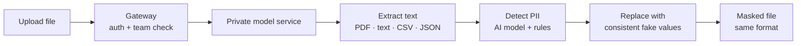

<div align="center">

# 🛡️ PII Masking System

**分享文档，而非身份。**
在 PDF、文本、CSV 和 JSON 中自动查找并替换姓名、证件号、地址、电话号码等信息，且不破坏文件。

[](../../LICENSE)


🌍 其他语言：
[English](../../README.md) · [Nederlands](README.nl.md) · [Français](README.fr.md) · [Deutsch](README.de.md) · [Español](README.es.md) · [Română](README.ro.md) · [العربية](README.ar.md) · **简体中文**

</div>

---

## 为什么你需要它

把医疗信函、人事档案或客服工单交给供应商、研究团队或测试环境时，通常需要有人手动遮盖个人数据。这既慢，又只要漏掉一个名字就会造成泄露。

- 📄 **文档保持完整。** 输入 PDF，输出 PDF；文本、CSV 和 JSON 同样如此。
- 🎭 **替换而非简单删除。** 检测到的值会被替换为逼真的虚构值（不同的姓名、看起来有效的证件号），每次替换结果一致，因此文件依然可读，适合测试与分析。
- 🔒 **真正移除数据。** PDF 文本会从文件中彻底删除；扫描页可通过 OCR 读取并移除其像素。不会有内容藏在黑色方块下面。
- 🌍 **支持多种语言。** 检测会对每份文档应用所有国家的规则，所以荷兰语信件中的法国证件号同样能被发现。替换值使用文档本身的语言书写（荷兰语/比利时、法语、德语、西班牙语、罗马尼亚语、英语）。
- 🧪 **选择最适合的模型。** 三个独立构建的 AI 模型位于同一个 API 之后，内置排行榜用同一测试集对它们一视同仁地评分。
- 🧱 **安全设计。** 仅网关对外暴露。模型运行在私有网络中，请求需认证，审计日志中绝不包含检测到的值。

## 检测内容

姓名、日期、年龄、性别、机构、地址、电话号码、电子邮件、URL，以及国家和医疗标识符（例如比利时的 INSZ/NISS、RIZIV/INAMI 和增值税号，以及法国、德国、西班牙和英美的标识符），并通过校验和验证减少误报。

## 工作原理



一个公开的 HTTP 端点（`POST /v1/mask`）位于所有模型之前。调用方从不选择模型 URL，因此运行什么始终由平台掌控。

## 模型

| 模型 | 技术 | 文件类型 | 状态 |
| --- | --- | --- | --- |
| **Octo** | XLM-RoBERTa + 校验和规则 | PDF、文本、CSV、JSON | 可演示 |
| **Synthify** | GLiNER | PDF、文本 | 仅演示 |
| **Berts** | int8 ONNX MedRoBERTa / BERT / CamemBERT + 共享规则 | PDF、文本 | 已接入生产，需 staging 审批 |

所有模型都通过 ONNX Runtime 在 CPU 上运行。

## 快速开始

```sh
uv run --no-project --with kagglehub python scripts/fetch_models.py --team octo   # download the weights
cp .env.example .env              # set SERVICE_TOKEN to a long random value
docker compose --profile octo up --detach --build
curl http://localhost:8080/health # {"status":"UP"}
```

模型权重不在本仓库中，而是托管在 [Kaggle](https://www.kaggle.com/models/yassienwasfy/pii-masking-system)，附有模型卡和每个模型各自的许可证；`scripts/fetch_models.py` 会下载权重，并用脚本中固定的 SHA-256 校验每个文件。三个 Berts 检查点来自第三方，其许可证尚未确认，见 [NOTICE](../../NOTICE)。

遮盖一个文本文件：

```sh
curl -sS -X POST http://localhost:8080/v1/mask \
  -H "Authorization: Bearer $SERVICE_TOKEN" \
  -H "X-Request-ID: demo-001" -H "Idempotency-Key: demo-001" \
  -H "X-Team-ID: octo" \
  -H "X-Source-Object-Key: incoming/octo/demo-001/letter.txt" \
  -H "X-Source-ETag: demo" \
  -H "Content-Type: text/plain" -H "Accept: text/plain" \
  --data-binary @letter.txt -o masked.txt
```

更喜欢点击操作？导入 [Postman 集合](../../postman/README.md)。完整请求头列表及所有端点：[docs/current-endpoints.md](../../docs/current-endpoints.md)。本地演示详情：[docs/multimodel-deployment.md](../../docs/multimodel-deployment.md)。

> **本公开仓库不包含模型权重**（体积大，且部分受第三方许可证约束，见 [NOTICE](../../NOTICE)）。请自行导出或将产物放入 `teams/<team>/onnx/`；参见 [docs/team-onboarding.md](../../docs/team-onboarding.md)。下面的快速开始需要它们。

## 文档

| 阅读 | 了解 |
| --- | --- |
| [架构](../../docs/architecture.md) | 各部分如何协作 |
| [仓库指南](../../docs/repository-guide.md) | 各目录归谁负责 |
| [团队接入](../../docs/team-onboarding.md) | 如何添加或改进模型 |
| [API 契约](../../contracts/masking-api/) | 带版本的 HTTP 契约 |
| [安全与机密](../../docs/security-and-secrets.md) | 凭据与数据的处理 |
| [决策记录](../../docs/decisions/) | 为何如此设计 |

## 贡献与安全

请先阅读 [CONTRIBUTING.md](../../CONTRIBUTING.md)。本仓库**仅接受合成数据**；切勿提交真实个人数据或凭据。报告漏洞请遵循 [SECURITY.md](../../SECURITY.md)，不要公开提交包含细节的 issue。

## 许可证

代码采用 [Apache License 2.0](../../LICENSE) 授权。在贡献者拥有权利的前提下，模型文件同样以 Apache-2.0 提供，但每个模型仍受其所基于的上游模型许可证约束。各模型的详细信息见 [NOTICE](../../NOTICE)，其中包括一组上游许可证尚未确认的权重。

---

开发者：请参阅[英文 README](../../README.md) 中的 *Development* 部分。
